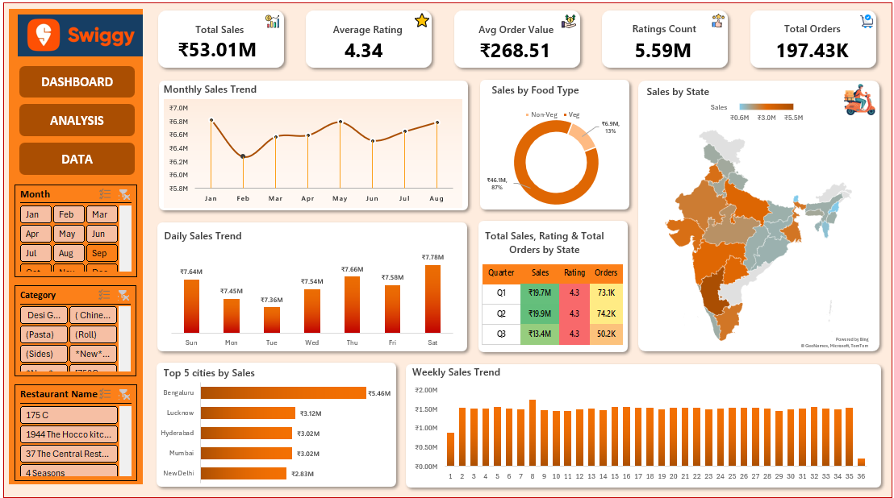

# 📊 Swiggy Sales Analysis Dashboard

## 📌 Project Overview

This project is an interactive **Swiggy Sales Analysis Dashboard** created using Microsoft Excel.

The dashboard provides insights into sales performance, customer ratings, orders, food categories, and state-wise sales distribution.

The main objective is to transform raw sales data into meaningful business insights using Excel.

## 🛠️ Tools & Technologies

- Microsoft Excel
- Pivot Tables
- Pivot Charts
- Slicers
- Data Analysis
- Data Visualization

## 📈 Dashboard Preview

## 📊 Key Performance Indicators (KPIs)

| KPI | Value |
|---|---:|
| Total Sales | ₹53.01M |
| Average Rating | 4.34 |
| Average Order Value | ₹268.51 |
| Ratings Count | 5.59M |
| Total Orders | 197.43K |

## 📌 Dashboard Features

### 1. Monthly Sales Trend
Analyzes monthly sales performance.

### 2. Daily Sales Trend
Displays sales performance across different days of the week.

### 3. Weekly Sales Trend
Shows weekly sales patterns.

### 4. Sales by Food Type
Compares Veg and Non-Veg sales.

### 5. Sales by State
Visualizes state-wise sales distribution across India.

### 6. Quarterly Performance
Analyzes quarterly sales, ratings, and total orders.

### 7. Top 5 Cities by Sales
Identifies the top-performing cities based on sales.

### 8. Interactive Filters
Allows users to filter dashboard data by:
- Month
- Category
- Restaurant Name

## 🎯 Project Objectives

- Analyze Swiggy sales performance.
- Understand customer ratings and order trends.
- Identify top-performing cities and states.
- Compare Veg and Non-Veg sales.
- Build an interactive Excel dashboard.
- Present business insights through visualizations.

## 💡 Key Insights

- Total Sales: ₹53.01M
- Average Customer Rating: 4.34
- Average Order Value: ₹268.51
- Total Orders: 197.43K
- Ratings Count: 5.59M

## 🚀 How to Use

1. Download or clone this repository.
2. Open the Excel workbook.
3. Navigate to the Dashboard sheet.
4. Use interactive filters to explore sales performance.
5. Analyze the visualizations and KPIs.

## 👩‍💻 Author

Aspiring Data Analyst

---

⭐ If you find this project useful, don't forget to star this repository!
